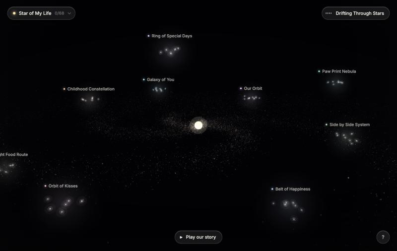
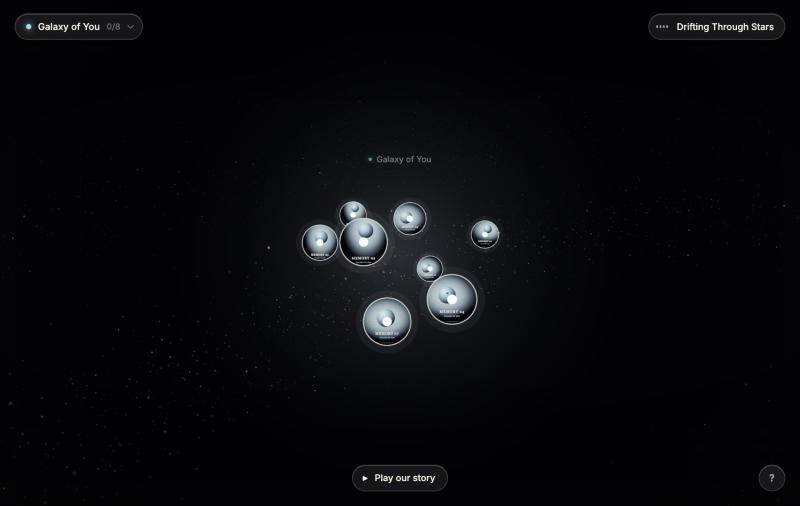
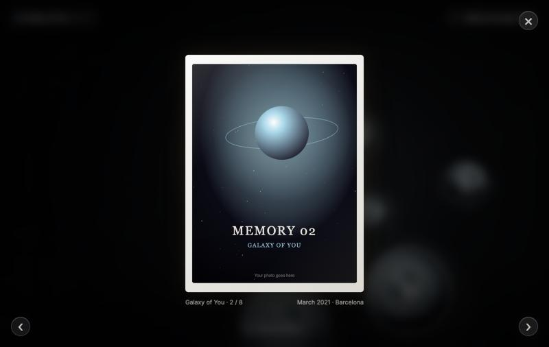
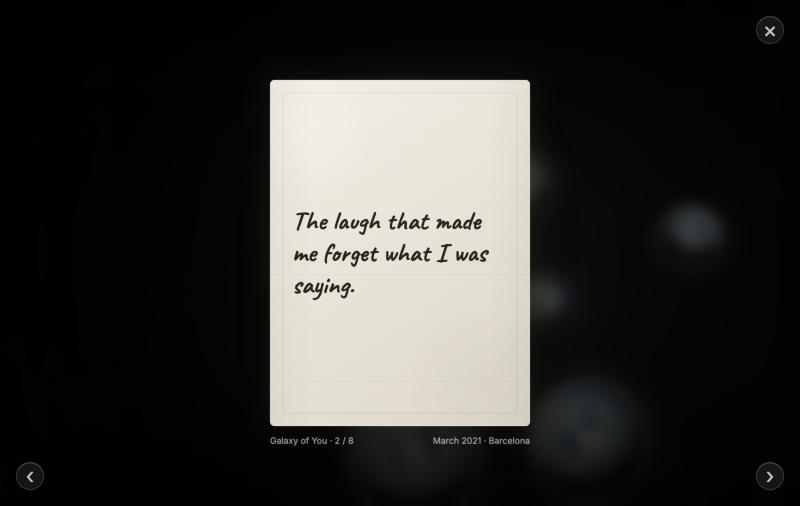

# Memory Universe ✦

**A 3D photo-album gift that turns your photos into planets and your memories into a universe.**

Build a universe for someone you love: every photo becomes a planet, every album chapter a star system, and at the center shines the star everything revolves around. Click a planet and the camera flies to it, the photo opens as a card, and flipping the card types out the note written on its back.

[Türkçe](README.tr.md)



| Photo moons | Memory card | Note on the back |
|---|---|---|
|  |  |  |

## Features

- 🪐 **Every photo is a planet**, grouped into color-coded systems (album chapters).
- 🖼️ **Photos in the universe**: as you fly closer, planets turn into round photos, and a card grows out of the one you click.
- 💌 **Flippable memory cards** with a handwritten note on the back, plus an optional date and place. Portrait and landscape photos both fit.
- ⭐ **A center star** for your most important message.
- ▶️ **Story mode**: "Play our story" visits every memory in order by itself (flight, photo, note, next) and ends at the center star. Perfect to just sit back and watch.
- ✈️ **Cinematic camera**: an intro flight, smooth travel between planets, and a slow drift when left alone.
- 🌠 **Little touches**: occasional shooting stars, and music that fades in and softens while a memory is open.
- 🎵 **Music player** with your own playlist.
- ✅ **Progress tracking**: visited planets dim and the menu shows counters like `3/12`.
- 📱 **Made for phones too**: swipe between memories, swipe down to close, and a lighter scene on mobile devices. On desktop you can also fly freely with `W A S D` / `Q E`.
- 🧭 **Easy to pick up**: a `?` card with all controls, and a link preview image for sharing.
- 🌍 **English and Turkish interface** (`language: "en" | "tr"`).
- 🧩 **No code required**: edit one `config.js` and drop photos into folders. No build step, nothing to install.

## Make your own in 5 steps

### 1. Get the project

Click **Use this template** or **Fork**, or clone it:

```bash
git clone https://github.com/<your-username>/<repo-name>.git
```

### 2. Add your photos

Each system has a folder under `universe/photos/`. Delete the sample images and drop in your own:

```
universe/photos/
├── first-date/
│   ├── 01.jpg
│   ├── 02.jpg
│   └── 03.png
└── holidays/
    ├── 01.jpg
    └── 02.webp
```

> 💡 Resizing photos to about 1600 px on the long edge makes the site load much faster.
>
> 🔒 Photos taken with a phone often contain the exact GPS location where they were taken. Remove it before adding them (on a Mac: *Photos → File → Export*, then untick *Location Information*).

### 3. Edit `universe/config.js`

```js
export default {
  language: "en",
  title: "Name's Universe",

  intro: {
    eyebrow: "From Name, to Name",
    subtitle: "I built you a universe.",
    button: "Enter the universe",
    line: "For you, always.",
  },

  center: {
    name: "Star of My Life",
    color: "#ffe3a1",
    message: "The message at the heart of your universe…",
  },

  systems: [
    {
      id: "first-date",              // same as the photo folder name
      name: "First Date Galaxy",
      color: "#ff9fb7",            // optional
      memories: [
        { photo: "01.jpg", text: "It was raining that day…", date: "14 Feb 2023", place: "Istanbul" },
        "02.jpg",                     // a photo without a note
        "03.png",
      ],
    },
  ],

  music: [{ title: "Our Song", file: "our-song.mp3" }],
};
```

| Field | Description |
|---|---|
| `language` | Interface language: `"en"` or `"tr"`. |
| `systems[].id` | Name of the photo folder. Use lowercase letters, numbers and dashes (`first-date`). |
| `systems[].memories` | Planets, in order (story mode follows the order of systems and memories). Just the file name, or `{ photo, text, date, place }` to add a note (`\n` for a line break) and when/where it was. `date` and `place` are free text shown under the card. |
| `systems[].color` | *Optional.* The system's color. Leave it out and the system gets a random pale color that keeps clear of the other systems' tones. It's picked from the system's `id`, so it stays the same on every visit, and adding a system never changes the others. |
| `systems[].position` | *Optional.* Where the system sits in space, as `[x, y, z]`. Without it, systems are spread evenly around the center. |
| `systems[].planetScale` | *Optional.* Smallest and largest planet size, e.g. `[1.5, 2.6]`. |
| `music` | Songs in `universe/music/`. If the list is empty, the music player is hidden. |

### 4. Preview it locally

Browsers don't load JavaScript modules from a double-clicked `index.html`, so run a tiny local server. Python ships with macOS and Linux:

```bash
python3 -m http.server 8000 --bind 127.0.0.1
```

Then open <http://localhost:8000>. Add `?skipIntro` to the address to skip the intro.

> 🔒 `--bind 127.0.0.1` keeps the server visible to your computer only. Without it, anyone on the same Wi-Fi (a café, school or office network) could open your photos while it runs.

### 5. Publish

- **GitHub Pages:** in your repo go to *Settings → Pages → Branch: `main` / root* and click Save. After a minute or two the site is live at `https://<your-username>.github.io/<repo-name>/`.
- **Link preview:** in `index.html`, change the `og:image` path to the full address (e.g. `https://<your-username>.github.io/<repo-name>/docs/share-preview.jpg`) so the preview image shows up when you share the link. You can replace the image itself too.
- **Cloudflare Pages:** create a Pages project, connect your repo (no build command, output directory `/`), and deploy. Or upload the folder directly.
- **Netlify Drop:** drag the project folder onto <https://app.netlify.com/drop>.

> ⚠️ **Privacy:** anything in a public GitHub repo or on GitHub Pages is public. To keep your real photos private, use the private copy described below and host it somewhere else. The included `robots.txt` asks search engines not to index the site.

## Private copy

`universe/` is the sample universe that lives in the repo. Put your real gift in **`my-universe/`** instead. It's git-ignored, so it never gets pushed:

```bash
cp -R universe my-universe
```

Open it at <http://localhost:8000/?universe=my-universe>. When you publish the gift, put its contents in place of `universe/` (or add `?universe=my-universe` to the link) and upload only your own copy.

## Controls

| | Desktop | Mobile |
|---|---|---|
| Look around | Drag | Drag with one finger |
| Zoom | Mouse wheel | Pinch |
| Fly | `W A S D`, `Q E` to go down / up, hold `Shift` to go faster | — |
| Back to center | `H` or the top-left menu | Top-left menu |
| Next / previous memory | `←` `→` | Swipe left / right or ‹ › |
| Close a memory | `Esc` | Swipe down |
| Flip a card | Click the card | Tap the card |

## Project structure

```
├── index.html
├── universe/          sample universe: config, photos, music
├── my-universe/       (git-ignored) your private universe
├── src/
│   ├── main.js        entry point: loads the universe
│   ├── app.js         scene, interaction and camera flow
│   ├── content/       reads the config, interface translations
│   ├── core/          camera flights, visited store, image preloading
│   ├── scene/         Three.js: stars, planets, galaxy, camera controls
│   ├── ui/            intro, memory card, music player, system menu
│   └── utils/         shared helpers
├── styles/            one CSS file per component
├── fonts/             bundled fonts (Inter, Caveat) and their licenses
├── vendor/three/      bundled Three.js 0.160.0 (MIT)
├── docs/              README images and link preview
└── _headers           security headers for Cloudflare Pages / Netlify
```

**Built with** plain HTML, CSS and JavaScript modules plus [Three.js](https://threejs.org). No bundler, no dependencies to install.

### Self-contained and locked down

- **Works offline.** Three.js and the fonts are bundled in the project, so the site never contacts another server, not even a CDN or Google Fonts.
- **Strict security policy.** A Content Security Policy in `index.html` only lets the page load its own files. Even if someone managed to inject code, the browser would refuse to run anything from elsewhere. On Cloudflare Pages and Netlify, `_headers` also stops other sites from embedding yours and turns off camera, microphone and location access.
- **Editing the import map?** The policy allows the inline import map by its hash. If you change it, recalculate the hash (`openssl dgst -sha256 -binary | openssl base64` over the script's contents) and update `index.html`, or the page won't start.

## License

[MIT](LICENSE). The sample images and the two demo tracks were made for this project and are covered by the same license.
