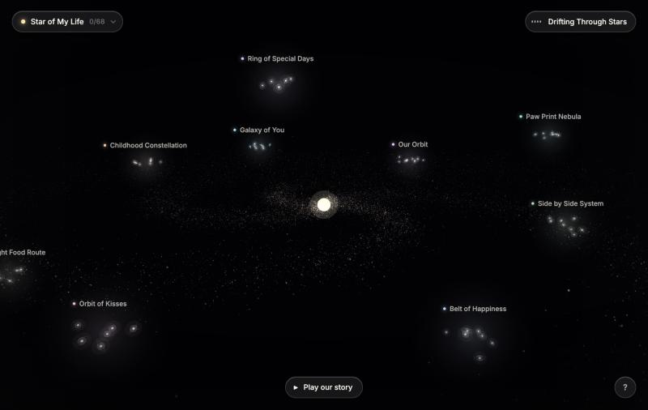
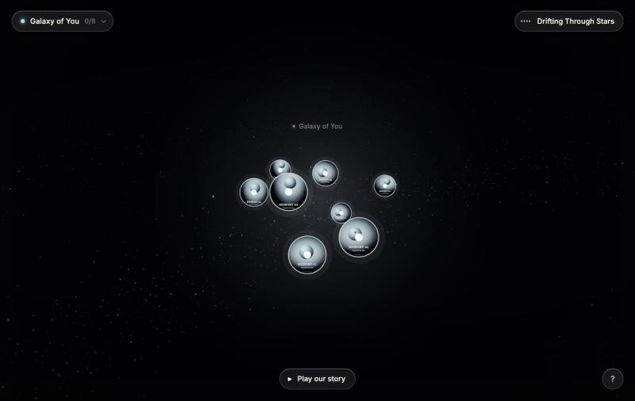
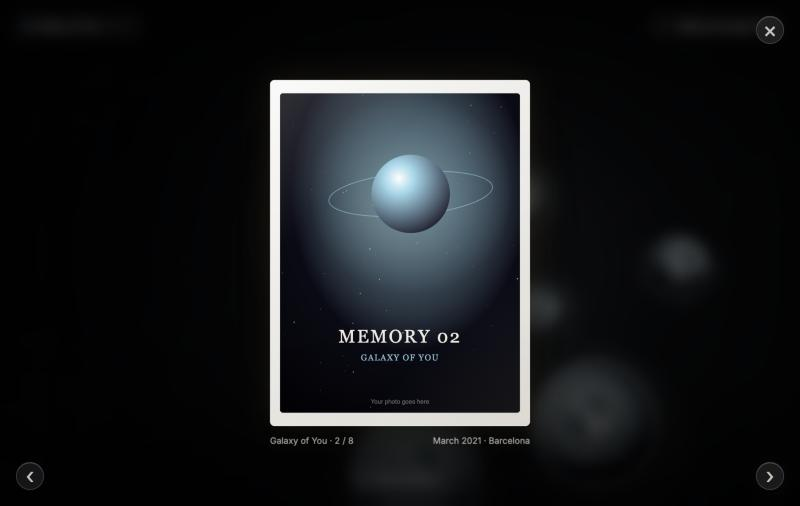
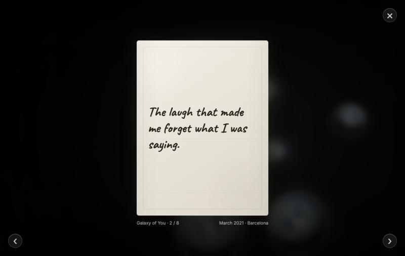

# Anı Evreni ✦

**Fotoğraflarınızı gezegenlere, anılarınızı bir evrene dönüştüren 3D albüm hediyesi.**

Sevdiğiniz kişi için bir evren kurun: her fotoğraf bir gezegen, her albüm bölümü bir yıldız sistemi, ortada da her şeyin etrafında döndüğü bir yıldız olsun. Gezegene tıklayınca kamera oraya uçar, fotoğraf bir kart olarak açılır ve kartı çevirince arkasındaki not daktiloyla yazılır.

[English](README.md)



| Fotoğraf ayları | Anı kartı | Arkasındaki not |
|---|---|---|
|  |  |  |

## Özellikler

- 🪐 **Her fotoğraf bir gezegen:** sistemlere (albüm bölümlerine) göre gruplanır ve her sistemin kendi rengi vardır.
- 🖼️ **Fotoğraflar evrende:** yaklaştıkça gezegenler yuvarlak fotoğraflara dönüşür, tıkladığın fotoğraftan kart büyüyerek açılır.
- 💌 **Çevrilebilen anı kartları:** arkasında el yazısıyla not, altında isteğe bağlı tarih ve yer. Dikey ve yatay fotoğraflar kendiliğinden uyum sağlar.
- ⭐ **Evrenin merkezi:** en önemli mesajın için özel bir yıldız.
- ▶️ **Hikâye modu:** "Hikâyemizi oynat" tüm anıları sırayla kendisi gezer (uçuş, fotoğraf, not, sonraki) ve merkez yıldızda biter. Oturup izlemek yeterli.
- ✈️ **Sinematik geçişler:** giriş uçuşu, gezegenler arasında yumuşak kamera hareketleri ve kimse dokunmadığında yavaş bir dönüş.
- 🌠 **Küçük dokunuşlar:** arada bir kayan yıldızlar; müzik yavaşça açılır, bir anı açıkken kısılır.
- 🎵 **Müzik çalar:** kendi çalma listenle.
- ✅ **İlerleme takibi:** gezilen gezegenler söner ve menüde `3/12` gibi bir sayaç görünür.
- 📱 **Telefona uygun:** anılar arasında parmakla kaydır, aşağı kaydırıp kapat; mobilde sahne otomatik hafifler. Masaüstünde `W A S D` / `Q E` ile serbestçe uçulur.
- 🧭 **Kolay başlangıç:** tüm kontrolleri anlatan `?` kartı ve paylaşım için link önizleme görseli.
- 🌍 **Türkçe ve İngilizce arayüz:** `language: "tr"` ya da `"en"`.
- 🧩 **Kod gerekmez:** tek bir `config.js` dosyasını düzenleyip fotoğrafları klasöre koyman yeterli. Kurulum ya da derleme adımı yok.

> Örnek evren (`universe/`) İngilizce hazırlandı. Kendi evreninde `language: "tr"` yazarsan arayüzün tamamı Türkçe olur.

## 5 adımda kendi evrenini oluştur

### 1. Projeyi indir

Sağ üstteki **Use this template** ya da **Fork** butonunu kullan veya:

```bash
git clone https://github.com/<kullanici-adin>/<repo-adi>.git
```

### 2. Fotoğraflarını koy

Her sistem için `universe/photos/` altında bir klasör vardır. Örnek görselleri sil, yerine kendi fotoğraflarını koy:

```
universe/photos/
├── ilk-bulusma/
│   ├── 01.jpg
│   ├── 02.jpg
│   └── 03.png
└── tatillerimiz/
    ├── 01.jpg
    └── 02.webp
```

> 💡 Fotoğrafları yüklemeden önce uzun kenarı en fazla ~1600 px olacak şekilde küçültürsen site çok daha hızlı açılır.
>
> 🔒 Telefonla çekilen fotoğraflar çoğu zaman çekildikleri yerin tam GPS konumunu içerir. Eklemeden önce bunu kaldır (Mac'te: *Fotoğraflar → Dosya → Dışa Aktar*, ardından *Konum Bilgisi* seçeneğinin işaretini kaldır).

### 3. `universe/config.js` dosyasını düzenle

```js
export default {
  language: "tr",
  title: "İsim'in Evreni",

  intro: {
    eyebrow: "İsim'den İsim'e",
    subtitle: "Sana bir evren bıraktım.",
    button: "Evrene giriş yap",
    line: "Hep senin için.",
  },

  center: {
    name: "Hayatım Yıldızı",
    color: "#ffe3a1",
    message: "Evrenin merkezindeki mesajın…",
  },

  systems: [
    {
      id: "ilk-bulusma",             // klasör adıyla aynı
      name: "İlk Buluşma Galaksisi",
      color: "#ff9fb7",            // isteğe bağlı
      memories: [
        { photo: "01.jpg", text: "O gün yağmur yağıyordu…", date: "14 Şubat 2023", place: "Kadıköy" },
        "02.jpg",                     // notsuz fotoğraf
        "03.png",
      ],
    },
  ],

  music: [{ title: "Bizim Şarkımız", file: "bizim-sarkimiz.mp3" }],
};
```

| Alan | Açıklama |
|---|---|
| `language` | Arayüz dili: `"tr"` ya da `"en"`. |
| `systems[].id` | Fotoğraf klasörünün adı. Küçük harf, rakam ve tire kullan (`ilk-bulusma`). |
| `systems[].memories` | Gezegen sırası (hikâye modu da sistemlerin ve anıların bu sırasını izler). Sadece dosya adını ya da not, tarih ve yer için `{ photo, text, date, place }` yaz (satır atlamak için `\n`). `date` ve `place` serbest metindir, kartın altında görünür. |
| `systems[].color` | *İsteğe bağlı.* Sistemin rengi. Yazmazsan sistem, diğer sistemlerin tonlarından uzak duran rastgele ve soluk bir renk alır. Renk sistemin `id`'sinden seçildiği için her ziyarette aynı kalır; yeni sistem eklemek diğerlerinin rengini değiştirmez. |
| `systems[].position` | *İsteğe bağlı.* Sistemin evrendeki yeri `[x, y, z]`. Yazmazsan sistemler merkezin etrafına eşit aralıklarla yerleşir. |
| `systems[].planetScale` | *İsteğe bağlı.* En küçük ve en büyük gezegen boyutu, ör. `[1.5, 2.6]`. |
| `music` | `universe/music/` klasörüne koyduğun şarkılar. Liste boşsa müzik çalar gizlenir. |

### 4. Bilgisayarında dene

Tarayıcılar güvenlik nedeniyle `index.html`'e çift tıklayınca modülleri açmaz, bu yüzden küçük bir sunucu gerekir. macOS ve Linux'ta Python hazır gelir:

```bash
python3 -m http.server 8000 --bind 127.0.0.1
```

Sonra tarayıcıda <http://localhost:8000> adresini aç. Giriş animasyonunu atlamak için adrese `?skipIntro` ekleyebilirsin.

> 🔒 `--bind 127.0.0.1` sunucuyu yalnızca senin bilgisayarına açık tutar. Bu olmadan, aynı Wi-Fi'daki herkes (kafe, okul, iş yeri ağı) sunucu çalışırken fotoğraflarını açabilir.

### 5. Yayınla

- **GitHub Pages:** repo → *Settings* → *Pages* → *Branch: `main` / root* → Save. Birkaç dakika sonra site `https://<kullanici-adin>.github.io/<repo-adi>/` adresinde açılır.
- **Link önizlemesi:** `index.html` içindeki `og:image` yolunu tam adresle değiştir (ör. `https://<kullanici-adin>.github.io/<repo-adi>/docs/share-preview.jpg`), böylece linki paylaşınca görsel görünür. Görselin kendisini de değiştirebilirsin.
- **Cloudflare Pages:** bir Pages projesi oluştur, repoyu bağla (derleme komutu yok, çıktı klasörü `/`) ve yayınla. Ya da klasörü doğrudan yükle.
- **Netlify Drop:** proje klasörünü <https://app.netlify.com/drop> sayfasına sürükle bırak.

> ⚠️ **Gizlilik:** GitHub Pages'teki her şey herkese açıktır. Kişisel fotoğraflarını herkese açık bir repoya koymak istemiyorsan aşağıdaki *Özel sürüm* yöntemini kullan ve siteyi başka bir yerden yayınla. `robots.txt` arama motorlarının siteyi listelemesini zaten engeller.

## Özel sürüm (gerçek içeriği repo dışında tutmak)

`universe/` klasörü örnek evrendir ve repoda durur. Gerçek hediyeni bunun yerine **`my-universe/`** klasöründe hazırlayabilirsin. Bu klasör `.gitignore`'da olduğu için GitHub'a hiç gitmez.

```bash
cp -R universe my-universe
```

Açmak için: <http://localhost:8000/?universe=my-universe>

Hediyeyi yayınlarken `my-universe/` klasörünün içeriğini `universe/` yerine koyup (ya da linke `?universe=my-universe` ekleyip) yalnızca kendi kopyanı yükle.

## Kontroller

| | Masaüstü | Mobil |
|---|---|---|
| Etrafa bakmak | Sürükle | Tek parmakla sürükle |
| Yakınlaşmak | Tekerlek | İki parmakla yakınlaştır |
| Uçmak | `W A S D`, alçalıp yükselmek için `Q E`, hızlanmak için `Shift` | — |
| Merkeze dönmek | `H` veya sol üstteki menü | Sol üstteki menü |
| Sonraki / önceki anı | `←` `→` | Sola / sağa kaydır veya ‹ › |
| Anıyı kapat | `Esc` | Aşağı kaydır |
| Kartı çevirmek | Karta tıkla | Karta dokun |

## Proje yapısı

```
├── index.html
├── universe/              ← örnek evren: config, fotoğraflar, müzik
├── my-universe/           ← (git'e girmez) senin özel evrenin
├── src/
│   ├── main.js            ← giriş noktası: evreni yükler
│   ├── app.js             ← sahne, etkileşim ve kamera akışı
│   ├── content/           ← config'i okur, arayüz çevirileri
│   ├── core/              ← kamera uçuşu, ziyaret kaydı, fotoğraf önyükleme
│   ├── scene/             ← Three.js: yıldızlar, gezegenler, galaksi, kamera
│   ├── ui/                ← giriş, anı kartı, müzik çalar, sistem menüsü
│   └── utils/             ← ortak yardımcılar
├── styles/                ← her bileşen için ayrı CSS dosyası
├── fonts/                 ← projeye dahil yazı tipleri (Inter, Caveat) ve lisansları
├── vendor/three/          ← projeye dahil Three.js 0.160.0 (MIT)
├── docs/                  ← README görselleri ve link önizlemesi
└── _headers               ← Cloudflare Pages / Netlify için güvenlik başlıkları
```

**Teknolojiler:** [Three.js](https://threejs.org) ile saf HTML, CSS ve JavaScript (ES modülleri). Derleme aracı ya da bağımlılık kurulumu gerektirmez.

### Kendi kendine yeten ve korumalı

- **İnternetsiz çalışır.** Three.js ve yazı tipleri projenin içinde; site başka hiçbir sunucuya (CDN ya da Google Fonts dahil) bağlanmaz.
- **Sıkı güvenlik politikası.** `index.html` içindeki Content Security Policy, sayfanın yalnızca kendi dosyalarını yüklemesine izin verir. Biri sayfaya kod sokmayı başarsa bile tarayıcı dışarıdan gelen hiçbir şeyi çalıştırmaz. Cloudflare Pages ve Netlify'da `_headers` dosyası ayrıca sitenin başka sitelere gömülmesini engeller, kamera/mikrofon/konum erişimini kapatır.
- **Import map'i mi değiştiriyorsun?** Politika, sayfadaki import map'e hash değeriyle izin verir. Değiştirirsen hash'i yeniden hesapla (betiğin içeriği üzerinde `openssl dgst -sha256 -binary | openssl base64`) ve `index.html`'de güncelle; yoksa sayfa açılmaz.

## Lisans

[MIT](LICENSE). Örnek görseller ve iki demo parçası bu proje için üretilmiştir ve aynı lisansla gelir.
